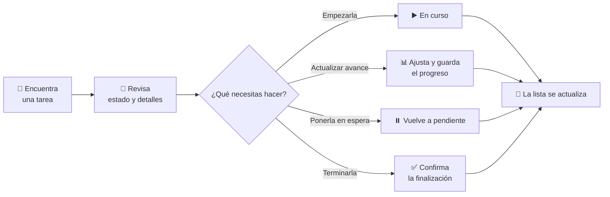

# 📋 Mis Tareas de Campo

Una vista clara y práctica para que los equipos de campo puedan **consultar y actualizar sus tareas** sin perder de vista el proyecto, el tiempo, las fechas ni los productos asociados.

> **Menos vueltas, más claridad:** encuentra una tarea, revisa su situación y actualízala desde una tarjeta visual.

## 🧭 De un vistazo



## 🗂️ ¿Qué muestra cada tarjeta?

| 👁️ En la tarjeta | 💡 Para qué sirve |
|---|---|
| **Proyecto y estado** | Identifica el proyecto y si la tarea está pendiente, en curso o completada. |
| **Aviso de fechas** | Si hay fecha de inicio y fin, indica cuánto falta para empezar, cuánto queda o cuántos días lleva vencida. |
| **Identificador y nombre** | Reconoce rápidamente la tarea. |
| **Tiempo** | Compara las horas imputadas con el esfuerzo estimado. |
| **Productos relacionados** | Resume cuántos productos están pendientes, instalados o devueltos. |
| **Barra de progreso** | Permite ver de un vistazo el avance registrado. |

### 🪪 Una tarjeta, en modo resumido

```text
┌──────────────────────────────────────────────┐
│ 📁 Proyecto  ·  🟡 Pendiente                 │
│ T-104   Revisión de instalación         ✏️   │
│ ⏱️ 2 h imputadas / 5 h estimadas              │
│ 📦 Pendientes 2 · Instalados 3 · Devueltos 0 │
│ 📊 Progreso  ████████░░░░░░░░  40 %           │
│                         ↓ Ver detalles       │
└──────────────────────────────────────────────┘
```

*Ejemplo ilustrativo: los datos y colores dependen de cada tarea.*

## 🔍 Encuentra lo que buscas

- **Busca** por nombre de tarea, identificador o número de proyecto. Los resultados se actualizan mientras escribes.
- **Filtra** la lista con tres opciones:
  - **Todas**: muestra las tareas que proporciona la vista.
  - **Pendientes**: deja a la vista las tareas pendientes.
  - **En curso**: muestra las tareas en las que ya se está trabajando.
- El contador junto al título indica cuántas tareas coinciden con la búsqueda y el filtro.
- Si no hay coincidencias, la pantalla lo indica para que puedas cambiar el texto o el filtro.

## 📖 Abre una tarea para ver y actualizar sus detalles

Selecciona una tarjeta para desplegar información adicional:

- **Tarea padre** y **descripción**.
- **Fechas de inicio y fin**; si no están definidas, se muestran como tales.
- **Progreso editable**, de 0 a 100 %. Mueve el control y pulsa **Guardar progreso** para aplicar el cambio.

El porcentaje elegido no se guarda automáticamente: puedes ajustarlo antes de confirmarlo. Al guardarlo, la tarea se actualiza y la lista vuelve a cargar sus datos.

## ▶️ Cambia el estado de trabajo

Las acciones disponibles dependen del estado actual:

| Estado actual | Acción | Resultado |
|---|---|---|
| 🟡 **Pendiente** | **Iniciar tarea** | Pasa a **En curso**. |
| 🔵 **En curso** | **Pausar / Pendiente** | Vuelve a **Pendiente**. |
| 🔵 **En curso** | **Completar tarea** | Solicita confirmación antes de marcarla como completada. |

Antes de completar, la confirmación recuerda comprobar si ya se cargaron todas las horas. **Cancelar** cierra el aviso sin completar la tarea.

## ✏️ Abre el formulario de la tarea

Usa el icono de edición de la tarjeta para abrir el formulario de esa tarea y consultar o editar su ficha en la aplicación.

## 📱 Pensada para el trabajo diario

- Las tarjetas se reorganizan según el espacio disponible, para facilitar la consulta en pantallas estrechas y amplias.
- La información clave queda a la vista; los detalles se despliegan solo cuando los necesitas.
- Mientras se cargan las tareas o se guarda un cambio, la interfaz muestra el estado de carga.
- El resumen de productos se consulta junto con las tareas. Si no está disponible, se informa en la tarjeta en lugar de mostrar un resumen incompleto como si fuera válido.

## 🚀 Uso en Power Platform

Este control PCF se incorpora a una aplicación de Power Platform y muestra las tareas disponibles en la vista/dataset con el que se configure. Para que la experiencia funcione, la aplicación debe permitir consultar y actualizar tareas y consultar sus productos relacionados.

> La lista y sus datos dependen de la configuración de la aplicación y de los permisos de la persona usuaria.

### Para desarrollo

Con las dependencias instaladas, los comandos habituales son:

```bash
npm install
npm run build
```

El control se identifica como **TareasMobile** y su versión actual es **0.0.12**.
